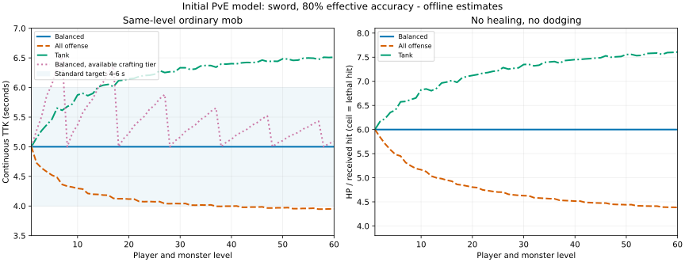

# Lv.1～60 初始 PvE 數值模型

狀態：**COMPLETED（模型、戰鬥接線、版本遷移與離線驗證）／NEEDS_VERIFICATION（Paper 實機與遊玩平衡）**。2026-10-18。初稿先完成純模型，後依使用者要求接入現有系統；最新部署、實際預算與遷移方式見 [BALANCE_RUNTIME.md](BALANCE_RUNTIME.md)。以下 CSV 仍表示標準角色的參考線。

這是一套可執行的初始設計，不是聲稱已經找出最佳平衡。以同級、當級標準裝備的單人 PvE 為基準，普通怪預估約 5 秒擊殺；玩家承受約 6 次普通命中死亡。裝備／配點決定優劣，敵人的招式與數量決定額外壓力，不用無限增加 HP 拖長戰鬥。

## 1. 交付與使用

- [Java 參考實作](../src/main/java/com/customrpg/balance/InitialBalanceModel.java)：無 Bukkit 依賴，含全部主要公式及 CSV 匯出，由 CombatBalance 與遷移接線呼叫。
- [Lv.1～60 逐級表](data/BALANCE_LEVELS_1_60.csv)：60 列，HP、配點、武器、怪物、Boss、魔力。
- [八種武器逐級表](data/BALANCE_WEAPONS.csv)：480 列，含攻速、基礎攻擊、每點主屬性係數。
- [敏感度驗算表](data/BALANCE_SCENARIOS.csv)：12,162 個不重複案例，涵蓋配點、八武器、裝備差、命中率、越級。
- [驗算測試](../src/test/java/com/customrpg/balance/InitialBalanceModelTest.java)：配點守恆、極端配點、慢武器、合成裝備斷層、防禦收益、四人 Boss、裸裝下限與輸入邊界。

重新產表（專案根目錄，JDK 21）：

```powershell
mvn '-Dtest=InitialBalanceModelTest' test
java -cp target/classes com.customrpg.balance.InitialBalanceModel docs/data
python tools/balance/plot_balance_model.py  # 選用；需 matplotlib，只讀 CSV 畫圖
```

匯出會覆寫上列三份模型 CSV，不會改 `CRAFTING_CATALOG.csv`。CSV 使用 UTF-8 BOM。程式內不四捨五入；CSV 僅為顯示取位，不應反過來作為戰鬥公式資料庫。

## 2. 計算條件與時間定義

所有 HP／傷害使用相同 RPG 單位。玩家客戶端可沿用現有 `HealthScale=20` 顯示，不代表真的只有 20 HP。

- 等級 `L` 僅 1～60，`n=L−1`。角色初始六項自由屬性均為 0，Lv.1 沒有額外配點，生命與魔力有保底。
- 標準配點：主攻 60%、體力 25%、餘數防禦；主攻與體力各向下取整，防禦吃餘數，點數不會因四捨五入增加。
- 標準裝備：當級普通品質、四件護甲＋兩飾品，詳細預算見第 5 節；主攻屬性配合當前武器，沒有種族／天賦／附魔額外加成。
- 基準為滿蓄力普攻、單體；攻擊機會有 80% 實際命中，沒有永久控制、回血或盾牌。命中率是走位、距離、射偏等造成的有效輸出比例，不是新增 20% 隨機 MISS。
- `DPS期望值 = 非暴擊單擊 × 攻速 × 命中率 × [1 + 暴率 × (暴傷−1)]`。
- `連續TTK = 怪物HP / 減傷後DPS`，是長期平均估算。CSV 的 `noncrit_discrete_ttk_s` 額外按整數刀數驗算：`[ceil(HP/非暴擊單擊)−1] / (攻速×命中率)`，從第一刀命中 t=0 計時。這仍是用平均命中間隔的近似，並非逐幀 AI 模擬。
- `hit_equivalents_to_die = 玩家HP / 每次實收傷害`，例如 7.61 表示第 8 次同傷害命中死亡，不是能完整吃下 7.61 下。實作需用未取位數值及適當浮點容差。
- 普通怪命中間隔以 1.8 秒估算；第一下命中 t=0 時，6 下約 9 秒致死。這是成功命中時間線；原版 AI、擊退與走位會改變實際間隔。

## 3. 玩家成長與「一次加多少」

**每次升級給 3 點自由屬性＋沿用 1 點天賦；點一次加 1 屬性、花 1 點。不再額外六屬性各 +1。**

```text
累計自由屬性點 P(L) = 3 × (L−1)            # Lv.60 共 177 點
主攻配點 = floor(0.60 × P)
體力配點 = floor(0.25 × P)
防禦配點 = P − 主攻配點 − 體力配點

HP = 100 + 8×(L−1) + 3×總體力 + 裝備平坦HP
MP = 80 + 2×(L−1) + 2×總精神 + 裝備平坦MP
每秒回魔 = 1.5 + 0.025×(L−1) + 0.06×總精神
```

「總屬性」包含自由配點、裝備、種族及天賦；**每個來源只加一次**。裝備平坦 HP 不得再換算成體力重複加入。自動 HP 成長是角色保底，不扣自由點。Lv.60 未配體力、無裝備也有 572 HP。

| 屬性 | 每投入 1 點的初始效果 | 限制與定位 |
|---|---|---|
| STR 力量 | 力量武器增加 `0.25×1.6/攻速×武器DPS係數` 非暴擊傷害 | 不再額外提高暴傷，避免同一屬性雙重放大 |
| MAG 魔法 | 魔法武器採相同係數；技能走同一攻擊力基底 | 技能不再另加一套固定魔法傷害；法杖普攻須有穩定可用入口 |
| AGI 敏捷 | 敏捷武器採相同係數；額外 +0.1 **百分點**暴率 | 不增加普攻速度；移速如實作建議每點 +0.05%、最多 +6%，此處未計入輸出 |
| VIT 體力 | 最大 HP +3 | 不同時增加斧頭傷害，讓生存與輸出確實有取捨 |
| DEF 防禦 | 防禦評分 +1，依下列曲線轉成減傷 | 不用「每點固定減傷百分比」 |
| SPR 精神 | MP +2、每秒回魔 +0.06 | 提供長戰續航；不直接給額外魔法傷害或永久 HP 回復 |

初始設計不加入被動隨機閃避。SPR、MAG 的價值需要用實際施法成本與長戰驗收，不能僅由普攻 CSV 宣稱各流派已平衡。

### 防禦與暴擊

```text
K = 60 + 2×防守者等級
減傷 DR = min(0.60, 總防禦 / (總防禦 + K))
實收傷害 = 原始傷害 × (1−DR)

暴率 C = min(0.30, 0.05 + 0.001×總敏捷 + 額外暴率)
暴傷倍率 M = min(1.75, 1.50 + 額外暴傷倍率)
```

防禦初版統一處理 RPG 物理／魔法傷害；環境、真傷、PvP 另訂規則，不直接混用。暴率全程採小數，`0.05=5%`；對接現有百分比設定時先除以 100。原版跳劈與 RPG 暴擊只能結算一次，不能再乘兩次。

Lv.60 標準角色總防禦 66，減傷 26.83%。此時體力 +1 約增加 0.41% HP，防禦 +1 約增加 0.41% 有效 HP，力量 +1 約增加 0.37% 普攻傷害。投資回報接近，但防禦無法防真傷、HP 也無法抵消所有高頻傷害。裸裝低等級時 DEF 收益較低，應在角色介面顯示實際收益。

## 4. 武器攻擊與技能預算

以劍為基準。`G` 是物品的有效等級，**不是持有者等級**；舊武器不會隨持有者自動升級。

```text
劍基礎攻擊 W(G) = 8 + 0.45×(G−1)
武器基礎攻擊 = W(G) × 1.6 / 攻速 × DPS係數
完整非暴擊單擊 = [W(G) + 0.25×主攻屬性] × 1.6 / 攻速 × DPS係數
```

慢武器連**屬性那部分**也要同比補償，不能只提高白字，否則高等級全部變成快武器最強。攻速欄是每秒攻擊次數；現有物品若以原版基礎 4 的 ADD_NUMBER modifier 寫入，才用 `modifier=攻速−4`，不可把 -2.4 當作每秒攻擊次數。

| 武器 | 主攻 | 攻速 | DPS係數 | Lv.1 白字 | Lv.60 白字 | 定位 |
|---|---|---:|---:|---:|---:|---|
| 劍 | STR | 1.60 | 1.00 | 8.00 | 34.55 | 單體基準 |
| 巨劍 | STR | 0.90 | 1.03 | 14.65 | 63.26 | 雙手、慢速、較高單擊 |
| 斧 | STR | 1.10 | 1.00 | 11.64 | 50.25 | 單體；如加破甲，需占額外預算 |
| 巨斧 | STR | 0.80 | 1.03 | 16.48 | 71.17 | 雙手爆發；不再用體力補輸出 |
| 鐮刀 | AGI | 1.20 | 0.95 | 10.13 | 43.76 | 保留一些範圍／流血空間 |
| 法杖 | MAG | 1.40 | 0.85 | 7.77 | 33.56 | 普攻稍低、技能與遠程收益較多 |
| 弓 | AGI | 1.00 | 0.95 | 12.16 | 52.52 | 射程收益；發射快照、不切手補傷 |
| 長槍 | STR | 1.20 | 0.97 | 10.35 | 44.69 | 攻擊距離／投擲；後續可把主攻預算拆為 STR/AGI |

表格白字供讀取，權威數值見 CSV／Java。這八種映射是新模型定義，不代表原本 `WeaponCategory` 已被修改。雙屬性武器如日後採 `0.7STR+0.3AGI`，應先算加權主攻值，再代公式，不能兩項都給完整係數。

### 種族、天賦、稀有度與主動技能

- 同等裝備下，種族、常駐天賦、稀有度、元素追加、暴率追加及技能輪轉的**合計額外單體持續輸出，先以基準普攻的 +25% 為上限預算**。不是每一來源都能各 +25%。
- 單次爆發可超過持續預算，但需由長冷卻、魔力或施法占用時間支付。例：每 8 秒一招，額外傷害 `2×自身普攻DPS`，無占用且沒其他加傷時，長期正好 +25%；若技能取代普攻，需扣掉施法期間失去的普攻。不要把這份額外傷害再當作完整技能總傷害重算。
- 該範例耗魔可從當前最大 MP 的 12% 起算；無 SPR 基準回魔約能支應一招／8 秒，無法免費支持四招全開。需要按 60 秒與 180 秒時間線測消耗、冷卻及實際施法次數。
- 暴擊、燃燒、召喚物、流血、連鎖、範圍命中都列入同一來源的預算。初始 AoE 可採首目標 100%、其餘 50%、最多六目標；這是待實作參數，尚未納入本輪單體驗算。
- 稀有度優先提供選擇與機制；同等級額外常駐傷害建議普通 0%、優良 2%、稀有 4%、史詩 6%、傳說 8%、神話 10%，一樣占合計預算。若這筆收益已寫在白字或屬性，不再乘第二次稀有度倍率。
- 永久種族特性建議先控制在約 +5% 輸出或有效 HP，避免成為十幾級裝備差。飛行、控制、射程、吸血等仍需實機評估，這份模型沒有把它們換成已驗證的 DPS。

基準 5 秒，在合計 +25% 穩定輸出時約 4 秒；這是標準配點的目標，不會禁止全攻流更快。所有技能／回血需沿用保護、PvP 與傷害取消規則。

## 5. 裝備屬性預算與七階合成銜接

下列是**整套四護甲＋兩飾品合計**，不是每件都給一遍。武器白字另按第 4 節計算。

```text
整套主攻 = floor(0.4×(G−1))
整套體力 = floor(0.2×(G−1))
整套防禦 = 10 + floor(0.5×(G−1))
```

第一版可用最大餘數法分到六格：主攻每格 1/6；體力與防禦以頭／胸／腿／腳／戒／項鍊 = 15%／30%／25%／15%／5%／10% 分配，取整後把餘數依小數部分由大到小分完。主題可搬移至 MAG、AGI、SPR，但不能每件同時得到全部主攻、生命、暴擊與抗性收益。若把主攻換成精神，需用施法續航補償而非宣稱普攻相同。

現有七階裝備的需求等級 **1、8、18、28、38、48、58** 保留；每階以自己的需求等級作 `G`，不使用階數 1～7 代替等級。當級標準裝備是連續參考線，實際只能買到／做出當前階裝備時另測；劍的最差預估 TTK 為 Lv.7 穿 Lv.1 裝備的 **6.52 秒**，可先接受，後續再決定是否增加過渡掉落。

不同主題的傷害係數、攻速係數不能各自無成本加成；例如攻擊 +3% 且攻速 +3% 已約 +6.09% DPS。980 件工坊裝備、既有 YAML 裝備、原版裝備都需重新按同一預算映射，這輪沒有批次覆寫或改已發放物品。

## 6. 怪物血量與傷害公式

怪物數值只取**怪物自己的等級與定位**，不讀目前玩家的配點來補強自己。低等怪不會因高等玩家靠近突然變硬。正式套用時仍由現有 WorldZone／模板決定怪物等級，不用玩家等級取代地區進度。

先用同級標準劍角色作固定參考：

```text
P = 3×(L−1)
主攻_ref = floor(0.6P) + floor(0.4×(L−1))
體力_ref = floor(0.25P) + floor(0.2×(L−1))
防禦_ref = P−floor(0.6P)−floor(0.25P) + 10 + floor(0.5×(L−1))

H_ref = 100 + 8×(L−1) + 3×體力_ref
DR_ref = 防禦_ref / (防禦_ref + 60 + 2L)
DPS_ref = [8 + 0.45×(L−1) + 0.25×主攻_ref] × 1.6 × 0.8 × 1.025

普通怪 HP = DPS_ref × 5
普通怪原始傷害 = H_ref / [6×(1−DR_ref)]
實際打中某玩家的傷害 = 普通怪原始傷害 × (1−該玩家DR)
```

這些係數由目標 TTK 與命中次數推導，因此「標準線恆定」是設計條件，不是測試發現了最佳參數；有價值的驗算在於更換武器、配點、裝備與命中率後是否仍合理。不同玩家實際 HP／防禦不會回寫怪物原始傷害。

### 定位倍率

| 定位 | 有效 HP 倍率 | 普攻傷害倍率 | 模型減傷 | 參考時間與壓力 |
|---|---:|---:|---:|---|
| 普通 | 1 | 1 | 0% | 5 秒，標準角色 6 次命中死亡 |
| 精英 | 3 | 1.35 | 10% | 約 15 秒；4.44 下等價，實際第 5 下死亡，需走位 |
| 荒野 Boss | 14 | 1.40 | 20% | 單人約 70 秒；合計 +25% 輸出約 56 秒 |
| 隊伍 Boss | 24×組隊係數 | 1.40 | 20% | 四人約 97.5 秒；合計 +25% 輸出約 78 秒 |

```text
怪物實際HP = 普通怪HP × 有效HP倍率 × (1−該定位減傷)
隊伍係數 = 1 + 0.75×(N−1)，N=1～8
```

只對隊伍 Boss 套組隊係數；`N` 應在開戰時由參與且合資格玩家固定，戰中加入／退出不重新變更 HP 或補血。Boss 傷害不隨人數倍增。模型的組隊欄假設四人都有標準輸出，未模擬一位純治療、死亡、跑位停手或仇恨機制。

減傷已扣進實際 HP，不能再拿有效 HP 倍率直接乘一次；否則會多得到一層耐久。初版不額外增加穿透，後續穿透可作為對有甲敵人的收益。

Boss 普攻約造成標準玩家 23.3% HP，重招可用普通怪原始傷害的 2.5 倍，約 41.7% HP；重招倍率是相對**普通怪**，不是再乘 Boss 的 1.4。Boss 高傷技能應有可見預警和閃避窗口。單人 56～70 秒戰鬥不能要求持續硬吃：必須限制不可避免的傷害、提供躲招機會與有成本的恢復；單靠 HP 公式不能證明 Boss 可單刷。

兩隻普通怪同時命中時壓力近乎翻倍，三隻會更危險。本輪不聲稱怪群已平衡；實機需測密度與巡邏，可另設弱小怪 HP／傷害 0.55 倍及錯開攻擊，不能讓初學者常被三隻完整普通怪同時黏住。

## 7. 逐級參考摘要

同級標準劍、80% 有效命中、5% 暴率／1.5 倍暴傷；數字為顯示取位。完整 60 級見 CSV。武器白字不含屬性，普攻是非暴擊完整單擊。

| Lv. | 累計配點 | 玩家 HP | 減傷 | 武器白字 | 完整普攻 | 普通怪 HP | 怪物原始攻擊 | 實收攻擊 |
|---:|---:|---:|---:|---:|---:|---:|---:|---:|
| 1 | 0 | 100 | 13.89% | 8.00 | 8.00 | 52.48 | 19.35 | 16.67 |
| 10 | 27 | 193 | 19.19% | 12.05 | 16.80 | 110.21 | 39.81 | 32.17 |
| 20 | 57 | 303 | 21.88% | 16.55 | 26.80 | 175.81 | 64.64 | 50.50 |
| 30 | 87 | 410 | 24.05% | 21.05 | 36.80 | 241.41 | 89.97 | 68.33 |
| 40 | 117 | 520 | 25.13% | 25.55 | 46.80 | 307.01 | 115.76 | 86.67 |
| 50 | 147 | 627 | 26.27% | 30.05 | 56.80 | 372.61 | 141.73 | 104.50 |
| 60 | 177 | 737 | 26.83% | 34.55 | 66.80 | 438.21 | 167.87 | 122.83 |

普通怪標準連續 TTK 均為 5 秒。無暴擊的整數刀數近似為 7 下、第一刀起算 4.69 秒。這兩種時間定義不能混在同一欄比較。

Lv.60 定位：精英實際 HP 約 1,183；荒野 Boss 約 4,908；四人隊伍 Boss 約 27,344。Boss HP 已由 v2 虛擬血量投影處理；一點 RPG 傷害扣一點實際 HP，原生事件保留致死與歸屬。

## 8. 驗算結果與限制



圖中命中次數為無回血的等價次數，向上取整才是致死那一下；曲線不是實機錄製。

| 案例 | 普通怪連續 TTK | 承傷／意義 |
|---|---:|---|
| 標準劍，當級參考裝備 | 5.00 秒 | 6 下等價 |
| 全攻劍，Lv.60 | 3.95 秒 | 4.38 下等價，第 5 下死亡 |
| 坦克劍，Lv.60；25% 主攻／45% 體力／餘數防禦 | 6.51 秒 | 7.61 下等價，第 8 下死亡 |
| 標準配點八武器，Lv.1～60 | 4.85～5.88 秒 | 慢武器無暴擊離散 TTK 約 4.17～5.36 秒 |
| 標準劍，只用目前可合成階級 | 最慢 6.52 秒 | 換裝前有壓力但不至於突然翻倍 |
| 標準劍，裝備落後十級 | 最慢 7.20 秒 | 應換裝，非自動追平 |
| 標準劍，有效命中降到 65% | 6.15 秒 | 實際操作會影響輸出 |
| 標準劍，越五級 | 5.40～8.13 秒 | 約 3.79～5.54 下等價；低等越級較危險 |
| 標準劍，越十級 | 5.88～11.25 秒 | 約 2.71～5.07 下等價；不再疊額外等差懲罰 |

這些是參考模型的敏感度，不是現有 153 個怪物 profile、980 件工坊裝備、164 個天賦或 12 種種族的全量戰鬥模擬。沒有完整驗證隨機暴擊分布、招式命中率、延遲、無敵幀、控場、原版盔甲／附魔、Boss AI 或盾牌。正式平衡必須以傷害日誌重測中位數與 P90，不能只看平均值。

回血會大幅改變壓力。v2 已接入離戰8秒後約每秒5%最大HP的回復、戰鬥治療預算、飽食回血取代與環境傷害單位轉換，詳見 [BALANCE_RUNTIME.md](BALANCE_RUNTIME.md)。這些效果未納入此處的單體參考 CSV。

## 9. 套用前盤點（歷史紀錄）

本節保留套用前查到的原始差異；v2 已完成對接，實際方案、來源預算與邊界見 [BALANCE_RUNTIME.md](BALANCE_RUNTIME.md)。表格的「現有路徑／差異」描述套用前基線。

| 現有路徑 | 核對到的差異 | 新模型對接要求 |
|---|---|---|
| `PlayerStatsManager.levelUp` | 每級 10 自由點＋六屬性各 +1，尚無此模型的 Lv.60 上限 | 自由點改 3、停止自動六項加點、玩家等級上限 60；天賦仍每級 1 |
| `PlayerStatsManager.updateMaxHealth`／`StatCalculator` | 使用 20＋2×體力；裝備 MAX_HEALTH 又轉成體力 | 共用 HP 公式與單一平坦 HP 欄，HUD 讀同一結果 |
| `StatsListener` | 只讀基礎 DEF、每點 0.5%、上限 75%；弓另加基礎 AGI | 改讀總 DEF 與遞減曲線；移除重複弓加成 |
| `WeaponListener`／`WeaponCategory` | 多種屬性係數與稀有度，直接覆寫自製武器基礎傷害 | 全傷害及屬性一起按攻速正規化，確保蓄力與一次暴擊 |
| `CraftingRangedListener` | 稀有度乘整體，近戰主要乘屬性；有額外固定 300 傷害上限 | 發射時快照相同公式，取消無依據的不同倍率／固定上限，保留等級檢查 |
| `DamageManager`／舊天賦與新天賦 | 不同技能的固定傷害、基礎或總 MAG 縮放不一；部分觸發倍率很高 | 全部技能做傷害／冷卻／命中次數／耗魔預算，不只改普攻 |
| `StatsGUI`／`StatCommand`／`StatCalculator` | 顯示力量 +0.5、介面暴率每 AGI +0.5%，實際近戰另用係數；`StatCommand` 把目前血量當最大血量 | 介面讀統一計算結果，不再各寫公式 |
| `MobData.calculateHealth/calculateDamage` | 各模板 base＋(level−1)×成長，沒有統一 TTK 目標 | 用本模型等級曲線＋定位／體型／招式預算，保留生態差異 |
| `MobListener.onVirtualHPDamage`、`MobManager.damageVirtualHP/healVirtualHP` | 超過 1024 HP 以 `virtualMax/1024` 放大傷害／治療，使有效耐久無法隨宣告 HP 增加 | RPG 最終傷害 100 就扣虛擬 HP 100；只在顯示實體 HP 時轉百分比；治療同理 |

虛擬 HP 的修正還必須包含致死事件／擊殺歸屬／掉落一次性、同 tick 多次傷害與治療、取消傷害、吸收血量及顯示同步。不能只移除比例，卻在虛擬 HP 歸零時仍期待少量原版傷害自然殺死剩很多顯示 HP 的實體。

Paper 的 `setDamage(double)` 修改的是基礎傷害，`getFinalDamage()` 才是套用傷害減免後的結果。模型只預算一次防禦；原版盔甲、附魔與抗性應折到同一計算層或明訂獨立預算，不能把公式結果直接塞 `setDamage` 後又被原版減一次，卻宣稱實收傷害符合表格。參見 [Paper 1.21.11 EntityDamageEvent](https://javadocs.papermc.io/paper/1.21.11/org/bukkit/event/entity/EntityDamageEvent.html)。蓄力應在攻擊時讀取並驗證，參見 [HumanEntity.getAttackCooldown](https://javadocs.papermc.io/paper/1.21.11/org/bukkit/entity/HumanEntity.html#getAttackCooldown())；原版已套過與插件覆寫時不可重複縮放。

### 原遷移規劃（歷史紀錄）

1. 先做單一戰鬥計算入口與傷害日誌，記錄攻擊者／物品版本／原始傷害／每層減免／最終扣血／虛擬 HP。PvE、PvP、環境傷害分辨來源。
2. 備份後以明確版本一次性遷移。因舊 base stats 混有自動 +1、自由點與管理員調整，不能直接扣 `(L−1)` 猜原配點；可將舊角色重配為 177 以內的新合法預算並保留原始快照與管理員補償紀錄，實際已採按比例保留取向的版本遷移，完整原檔備份；參見部署文件。Lv.60 以上角色也需獨立轉換規則。
3. 物品 ID 保留，以有效等級與版本重算；舊背包物品、村民庫存、配方輸出、掉落一起換版本，發射物保存當次公式快照。不得用顯示 lore 作數值來源。
4. 同時處理種族、天賦、技能與虛擬 HP，再切換玩家／怪物公式；不要只先降低怪物 HP 或配點，留下數倍舊傷害。
5. 測試服記錄 Lv.1/8/18/28/38/48/58/60，普通、精英、三怪群、荒野／四人 Boss。普通單人標準角色先以中位數 4～6 秒、同傷普通命中約 6 次死亡驗收；七階換裝前可容許接近 6.6 秒，另測新手低命中與高延遲 P90。Boss 要實際證明躲招、治療與參與人數假設可行。

## 10. 本輪驗證紀錄

- 初始模型專用測試：9 項通過。
- CSV：60 級、480 武器列、12,162 不重複敏感度案例，由同一 Java 實作產生。
- 初稿 `mvn verify`：367 項通過；套用 v2 後 `mvn clean verify`：415 項通過，0 failures／errors／skipped，紀錄 `target/balance-runtime-clean-verify.log`。
- 程式已接入新數值與自動遷移，部署新 JAR 後生效；本機未啟動 Paper，也未直接操作運行中伺服器資料。
